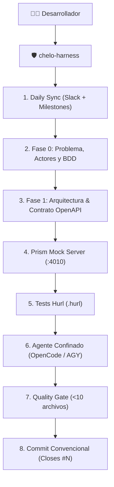

# 🛡️ Chelo-Harness

> **Coding-Agent Runtime con Gobernanza, Metodología Spec-First (OpenAPI + Prism + Hurl), Sincronización Daily Scrum y Gestión Ágil con Daily Board.**  
> *Inspirado en la ingeniería de software de la cátedra de Spec-First (ISFDyT 166) y la filosofía de arneses de Harness (Harness).*

[](LICENSE)
[](https://github.com/jmrodev/chelo-harness)

---

## ⚡ Instalación Rápida (One-Liner)

En tu terminal Linux o macOS:

```bash
curl -fsSL https://raw.githubusercontent.com/jmrodev/chelo-harness/main/install.sh | bash
```

### Herramientas Recomendadas:
- **Prism CLI**: `npm install -g @stoplight/prism-cli`
- **Hurl**: `yay -S hurl` (Arch) o desde [hurl.dev](https://hurl.dev)
- **GitHub CLI**: `gh auth login`

---

## 🧠 ¿Por qué Chelo-Harness?

Dejar que una IA escriba código libremente en un repositorio genera deuda técnica, rotura de contratos y alucinaciones. **Chelo-Harness doma al modelo imponiendo una cerca de contención (Bounded Context)**:



---

## 📖 Comandos Disponibles

| Comando | Descripción |
| :--- | :--- |
| `chelo-harness` | Inicia sesión ágil guiada (Daily Sync -> Requerimientos -> Agente). |
| `chelo-harness sync` | Consulta canales del equipo (Slack `#practicas`) y Milestones de GitHub. |
| `chelo-harness board init` | Inyecta el tablero [Daily Board](https://github.com/jmrodev/daily-board) en GitHub Pages. |
| `chelo-harness board open` | Abre el Daily Board del repositorio en el navegador. |
| `chelo-harness story` | Inicia entrevista con **Story-Agent (Product Owner)** para modelar BDD. |
| `chelo-harness agent <rol>` | Lanza un agente confinado **en modo autónomo** (lee, lista y escribe en `docs/`). |
| `chelo-harness mock` | Levanta **Prism Mock Server** en `:4010` leyendo el `openapi.yaml`. |
| `chelo-harness proxy [url]` | Levanta **Prism Proxy** validador contra el backend real en `:8000`. |
| `chelo-harness test` | Ejecuta la batería de pruebas Hurl (`*.hurl`) contra el contrato. |
| `chelo-harness gate` | Ejecuta el Quality Gate (Freno de 10 cambios + Tests Hurl). |
| `chelo-harness commit "<msg>"` | Commitea con validaciones de gobernanza (sin firmas artificiales). |
| `chelo-harness status` | Muestra el estado del workspace bajo las reglas de Chelo. |

---

## 🔌 Servidor MCP (18 herramientas)

`lib/chelo_mcp.py` expone el arnés completo por stdio (JSON-RPC 2.0), para que cualquier
cliente MCP lo use como herramientas nativas.

```bash
# Registro en OpenCode (~/.config/opencode/opencode.json)
"mcp": {
  "chelo": {
    "type": "local",
    "enabled": true,
    "command": ["python3", "/home/USUARIO/.local/lib/chelo/lib/chelo_mcp.py"]
  }
}
```

| Grupo | Herramientas |
| :--- | :--- |
| Gobernanza | `chelo_status`, `chelo_audit_changes`, `chelo_quality_gate` |
| Contrato | `chelo_spec_read`, `chelo_contract_test` |
| Mock | `chelo_mock_start`, `chelo_mock_status`, `chelo_mock_stop` |
| Workspace | `chelo_stack`, `chelo_doctor`, `chelo_init`, `chelo_board_init`, `chelo_board_url` |
| Canales ágiles | `chelo_sync`, `chelo_slack_post` |
| Agentes | `chelo_agent_turn`, `chelo_pipeline` |
| Git | `chelo_commit` |

Todas aceptan `workspace` para operar sobre otro repo sin cambiar el cwd del servidor.
El mock corre en segundo plano con estado en `~/.local/state/chelo-harness/`.
`chelo_contract_test` levanta Prism por su cuenta si no está corriendo.

`sync`, `story`, `agent <rol>`, `board init` y `board open` están cableados tanto en el CLI
como en el MCP (`chelo_sync`, `chelo_agent_turn`, `chelo_pipeline`, `chelo_board_init`, `chelo_board_url`).

---

## 🧠 Function Calling (agentes autónomos)

`lib/ai/gemini_client.py` implementa el bucle estándar de *tool use*:

1. Las declaraciones viajan en `payload["tools"]` (`functionDeclarations`).
2. Si el modelo responde con `functionCall`, el arnés ejecuta la función local.
3. El resultado vuelve como `role: "function"` + `functionResponse`.
4. El ciclo se repite hasta que el modelo devuelve texto (máx. 5 pasos).

```bash
chelo-harness agent story-agent      # entra en el bucle autónomo
```

```python
run_agent_turn("story-agent", "…", use_tools=True)   # CLI y MCP
run_agent_turn("story-agent", "…")                   # una sola pasada (default)
```

### Sandbox

El agente **no** recibe el set completo de herramientas. Solo:

| Tool | Alcance |
| :--- | :--- |
| `read_file` | archivos dentro del workspace |
| `list_dir` | directorios dentro del workspace |
| `write_doc` | **solo** dentro de `docs/` |

`run_command` existe en `AVAILABLE_TOOLS` pero queda **fuera** del set de agentes: ejecución
de shell disparada por un modelo no se habilita por defecto. Toda ruta se resuelve con
`resolve()` y se verifica por contención, así que `..`, rutas absolutas y symlinks que
apunten afuera se rechazan antes de tocar el disco.

---

## 🔑 Variables de Entorno

Ningún canal ni ruta personal está hardcodeada. Todo se resuelve desde el
entorno o desde un `.env`.

Orden de búsqueda de credenciales: variables de entorno → el archivo apuntado
por `CHELO_ENV_FILE` → `.env` en el directorio actual o hasta tres padres →
`~/.config/chelo/.env`.

| Variable | Para qué |
|---|---|
| `CHELO_ENV_FILE` | Ruta a un `.env` que ya tenés, sin copiar secretos |
| `GEMINI_API_KEY` / `GOOGLE_API_KEY` | Agentes y pipeline |
| `SLACK_BOT_TOKEN` / `SLACK_USER_TOKEN` | Leer y publicar en Slack |
| `SLACK_WEBHOOK_URL` | Publicar sin token |
| `SLACK_CHANNEL_ID` | Canal por defecto (requerido por `sync` y `slack_post`) |
| `SLACK_USERNAME` | Nombre de publicación; si no está, usa el de la app |
| `SLACK_CHANNEL_PRACTICAS` | Alias de `SLACK_CHANNEL_ID`, por compatibilidad |

Si falta el canal, el comando lo dice en vez de publicar en uno adivinado.

---

## 🗂️ Estructura del Código

Un módulo por responsabilidad. La regla: si dos cosas cambian por motivos
distintos, van en archivos distintos.

```text
lib/
├── chelo_mcp.py              arranque del MCP (solo imports, ~20 líneas)
├── mcp/
│   ├── protocol.py           JSON-RPC por stdio; no sabe qué hace cada tool
│   ├── registry.py           catálogo: nombre, esquema y handler de cada tool
│   ├── runtime.py            captura de stdout, cambio de workspace, estado del mock
│   ├── schema.py             esquema de entrada común (`workspace`)
│   └── handlers/
│       ├── governance.py     status, audit_changes, quality_gate, commit
│       ├── contract.py       spec_read, contract_test
│       ├── mock.py           mock_start, mock_status, mock_stop
│       ├── workspace.py      stack, doctor, init, board_init, board_url
│       ├── channels.py       sync, slack_post
│       └── agents.py         agent_turn, pipeline
├── ai/
│   ├── gemini_client.py      HTTP + bucle de function calling
│   └── tools/
│       ├── files.py          read_file, list_dir, write_file, write_doc
│       ├── shell.py          run_command
│       ├── registry.py       qué tools existen y cuáles puede usar un agente
│       └── declarations.py   esquemas JSON que se envían a Gemini
├── orchestration/
│   ├── turn.py               un turno: prompt + modelo (+ bucle de tools)
│   ├── pipeline.py           la cadena Spec-First y sus reglas de corrección
│   ├── roles.py              dónde viven los roles y cuáles hay
│   └── cli.py                comandos story / agent
├── channels/
│   ├── secrets.py            de dónde salen las credenciales
│   ├── slack.py              leer y publicar mensajes
│   └── github.py             milestone activo e issues vía gh
├── core/                     gate, paths, runner, board, setup, init_project
├── spec/                     mock_engine, tester
└── ui/                       consola
```

`lib/chelo_mcp.py` se mantiene como entrada porque es el comando que registra el
cliente MCP; el resto se puede mover sin tocar la configuración del cliente.

---

## 📚 Documentación Detallada

- [Capítulo 01: Filosofía Spec-First y Contract-Driven](docs/01-filosofia-spec-first.md)
- [Capítulo 02: Arquitectura, Gobernanza y Frenos de Seguridad](docs/02-arquitectura-y-gobernanza.md)
- [Capítulo 03: Integración con Daily Board y Metodologías Ágiles](docs/03-integracion-daily-board-y-agile.md)

---

## 📄 Licencia y Autoría

Copyright (c) 2026 **Juan Marcelo Rodríguez** ([@jmrodev](https://github.com/jmrodev)). Distribuido bajo Licencia MIT.
