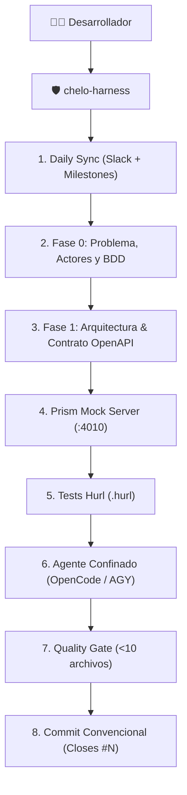

# 🛡️ Chelo-Harness

> **Coding-Agent Runtime con Gobernanza, Metodología Spec-First (OpenAPI + Prism + Hurl), Sincronización Daily Scrum y Gestión Ágil con Daily Board.**  
> *Inspirado en la ingeniería de software de la cátedra de Spec-First (ISFDyT 166) y la filosofía de arneses de Harness (Harness).*

[](LICENSE)
[](https://github.com/jmrodev/chelo-harness)

---

## ⚡ Instalación Rápida (One-Liner)

En tu terminal Linux o macOS:

```bash
curl -fsSL https://raw.githubusercontent.com/jmrodev/chelo-harness/main/install.sh | bash
```

### Herramientas Recomendadas:
- **Prism CLI**: `npm install -g @stoplight/prism-cli`
- **Hurl**: `yay -S hurl` (Arch) o desde [hurl.dev](https://hurl.dev)
- **GitHub CLI**: `gh auth login`

---

## 🧠 ¿Por qué Chelo-Harness?

Dejar que una IA escriba código libremente en un repositorio genera deuda técnica, rotura de contratos y alucinaciones. **Chelo-Harness doma al modelo imponiendo una cerca de contención (Bounded Context)**:



---

## 📖 Comandos Disponibles

| Comando | Descripción |
| :--- | :--- |
| `chelo-harness` | Inicia sesión ágil guiada (Daily Sync -> Requerimientos -> Agente). |
| `chelo-harness sync` | Consulta canales del equipo (Slack `#practicas`) y Milestones de GitHub. |
| `chelo-harness board init` | Inyecta el tablero [Daily Board](https://github.com/jmrodev/daily-board) en GitHub Pages. |
| `chelo-harness board open` | Abre el Daily Board del repositorio en el navegador. |
| `chelo-harness mock` | Levanta **Prism Mock Server** en `:4010` leyendo el `openapi.yaml`. |
| `chelo-harness proxy [url]` | Levanta **Prism Proxy** validador contra el backend real en `:8000`. |
| `chelo-harness test` | Ejecuta la batería de pruebas Hurl (`*.hurl`) contra el contrato. |
| `chelo-harness gate` | Ejecuta el Quality Gate (Freno de 10 cambios + Tests Hurl). |
| `chelo-harness commit "<msg>"` | Commitea con validaciones de gobernanza (sin firmas artificiales). |
| `chelo-harness status` | Muestra el estado del workspace bajo las reglas de Chelo. |

---

## 📚 Documentación Detallada

- [Capítulo 01: Filosofía Spec-First y Contract-Driven](docs/01-filosofia-spec-first.md)
- [Capítulo 02: Arquitectura, Gobernanza y Frenos de Seguridad](docs/02-arquitectura-y-gobernanza.md)
- [Capítulo 03: Integración con Daily Board y Metodologías Ágiles](docs/03-integracion-daily-board-y-agile.md)

---

## 📄 Licencia y Autoría

Copyright (c) 2026 **Juan Marcelo Rodríguez** ([@jmrodev](https://github.com/jmrodev)). Distribuido bajo Licencia MIT.
