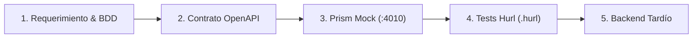

# 01. Filosofía Spec-First y Contract-Driven

> *"El Backend y la Base de Datos son un detalle tardío de implementación."* — Cátedra Juan López / Gentle-AI

## El Problema del Código sin Contrato
La mayoría de los agentes de IA generan código acoplado de inmediato a bases de datos, librerías de moda y estructuras desorganizadas. 
Cuando el frontend intenta consumir la API, los campos no coinciden, faltan tipos y el sistema colapsa bajo deuda técnica.

## Los 4 Pasos Inmutables de Chelo-Harness

1. **Requerimientos de Negocio (Fase 0)**:
   - Identificar problema manual previo.
   - Definir actores concretos.
   - Redactar escenario BDD (Given / When / Then).

2. **El Contrato Sagrado (`openapi.yaml`)**:
   - Definir rutas, schemas y ejemplos concretos.

3. **El Servidor Simulado (Prism Mock)**:
   - `chelo-harness mock` levanta un endpoint HTTP real sin escribir código de backend.

4. **El Juez de Cumplimiento (Hurl)**:
   - Pruebas HTTP en texto plano con aserción estricta: `header "sl-violations" not exists`.
   - Si la petición o respuesta no cumple la especificación, el test no pasa.
